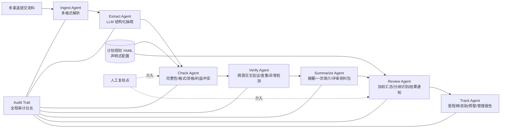

# GrantFlow · 申请评审与项目管理流程自动化 Agent

> 「智赋香江」AI 智能体应用大赛 · 指定赛道 · **场景 16**（教育与文化创意赛道 · 校内行政工作流方向）
> 参赛队伍：**KK_Garden**（2 人）

GrantFlow 面向大学、科技园、创投机构及创新创业支援单位，把「申请受理 → 资格审查 → 交叉验证 → 评审汇总 → 结果通知 → 项目追踪」的整条行政工作流交给智能体自动完成：

- **多渠道受理**：各计划申请表、附件（PDF/DOCX/PPTX/XLSX/CSV/图片/视频）统一摄取解析
- **声明式规则**：每个资助计划的要求、格式、资格、评审准则用 YAML 配置，无需改代码即可适配新计划
- **完整性 & 合规审查**：必填资料、附件、格式、资格条件、潜在利益冲突逐项核查，缺失/错误/异常自动标记
- **跨源交叉验证**：表单自报数据 vs 申请书内容自动比对，识别预算矛盾、信息不一致；批次级查重与预算离群检测
- **评审资料包**：自动生成标准化申请摘要、一页式项目简介、评审核对清单（Reviewer Pack）
- **评审汇总**：按维度权重计算加权总分，自动识别评分分歧并触发复议建议，生成结果通知与后续待办
- **项目追踪**：里程碑、资助发放、定期报告跟踪，逾期/临期自动预警，输出管理报告
- **全程可审计**：每个 Agent 动作写入审计日志，支持「人机协同」——关键节点显式标记需人工复核

## 快速开始

```bash
pip install -r requirements.txt   # 最小依赖仅 pyyaml（其余为可选解析库）

# 跑通 demo 全流程（离线、无需任何 API Key）
python cli.py

# 启动 Web 面板（http://127.0.0.1:8000）
python app.py

# 运行测试
python -m pytest tests -q
```

接入真实大模型（可选，显著提升抽取与摘要质量）：

```bash
export OPENAI_API_KEY=sk-...        # 支持任意 OpenAI 兼容端点
export OPENAI_BASE_URL=https://...  # 可选
export OPENAI_MODEL=gpt-4o-mini     # 可选
python cli.py --llm openai
```

## 架构



## 目录结构

```
├── configs/program_demo.yaml   # 示范计划规则（声明式配置）
├── data/demo/                  # 3 份示范申请（含异常用例）+ 评审评分
├── src/kkg/                    # 核心包
│   ├── ingest.py               # 多格式文档摄取（可选依赖、优雅降级）
│   ├── extract.py              # LLM 抽取 + 交叉验证 + 异常检测
│   ├── check.py                # 完整性/格式/资格/利益冲突/查重
│   ├── summarize.py            # 摘要 / 一页简介 / 评审资料包
│   ├── review.py               # 加权汇总 / 分歧识别 / 通知 / 待办
│   ├── track.py                # 里程碑 / 资助 / 预警 / 管理报告
│   ├── pipeline.py             # Agentic Workflow 编排 + 审计
│   ├── llm.py                  # 可插拔 LLM（Mock 离线可复现）
│   ├── program.py              # 计划规则模型
│   └── models.py               # 数据模型 + 审计日志
├── cli.py                      # 一键跑通全流程
├── app.py                      # FastAPI Web 面板
├── tests/                      # 端到端测试
└── docs/                       # 架构说明 / 计划书大纲 / 评审映射
```

## Demo 数据说明（故意内置异常，验证 Agent 检出能力）

| 申请 | 预期检出 |
|---|---|
| APP-2027-001 | ✅ 基本合规（仅建议项缺失提示） |
| APP-2027-002 | ⚠️ 表单预算 15 万 vs 申请书 9.5 万（跨源矛盾） |
| APP-2027-003 | ❌ 团队 9 人超上限、预算 200 万超计划上限 50 万、触发评审人利益冲突（CUHK）、与 APP-2027-001 疑似重复、预算批次离群 |

## 负责任 AI

- 所有自动化结论附 **severity + needs_human** 标记，关键决策（资格淘汰、利益冲突、复议）默认人工复核
- 审计日志记录每次 Agent 动作与依据，可追溯、可复现
- MockLLM 保证无外部调用时结果确定一致；真实 LLM 温度固定 0.2
- 数据仅在本机处理，不上传第三方

## 路线图

- [ ] 邮件/IMAP 渠道自动收件与附件归档
- [ ] 图片 OCR 与视频转写（接入多模态模型）
- [ ] 评审意见情感分析与评分校准建议
- [ ] 多计划并行受理看板（Supabase 持久化）
- [ ] MCP 工具封装，供其他 Agent 调用复用

---

License: MIT · Team: KK_Garden
