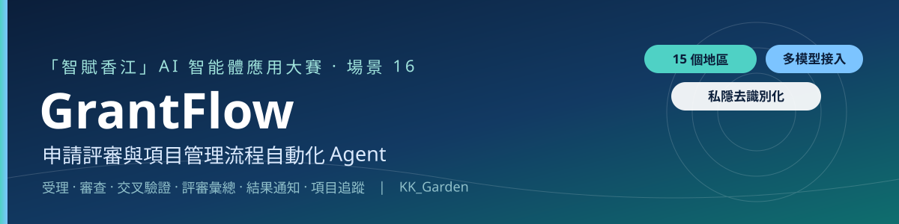
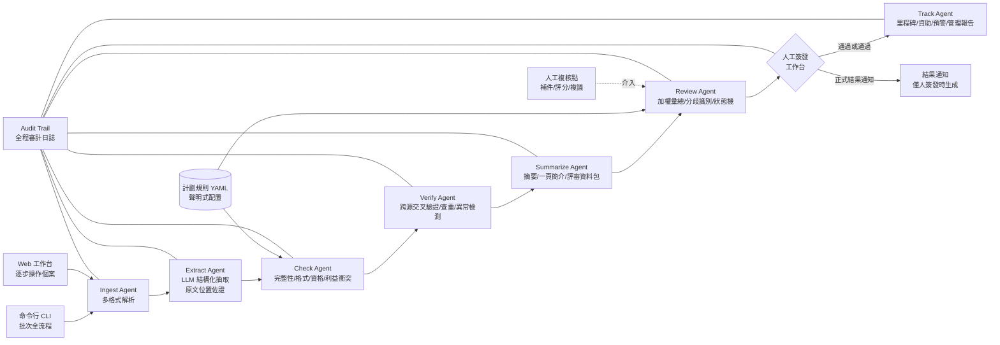

# GrantFlow · 申請評審與項目管理流程自動化 Agent

> 「智賦香江」AI智能體應用大賽 · 指定賽道 · **場景16**（教育與文化創意賽道 · 校內行政工作流方向）
> 參賽隊伍：**KK_Garden**（2人）

GrantFlow面向大學、科技園、創投機構及創新創業支援單位，把「申請受理、資格審查、交叉驗證、評審彙總、人工簽發、結果通知、項目追蹤」的整條行政工作流交給智能體自動完成。系統有兩個入口：一鍵跑完全流程的命令行（CLI），以及可逐步操作個案生命週期的網頁工作台；兩者共用同一套規則引擎，而正式結果通知只在工作台由人簽發，智能體永不自動發出。
每個資助計劃的差異做成配置，敏感資訊擋在本機，審查視角切換到當地。一套引擎因此可以適配不同計劃、不同地區、不同模型，而無需改動程式：

- **多渠道受理**：網頁表單、`.eml` 郵件附件及資料夾三種渠道；附件（PDF/DOCX/PPTX/XLSX/CSV/圖片/視頻）統一攝取解析
- **聲明式規則**：每個資助計劃的要求、格式、資格、評審準則用YAML配置，無需改代碼即可適配新計劃
- **完整性 & 合規審查**：必填資料、附件、格式、資格條件、潛在利益衝突逐項核查，缺失/錯誤/異常自動標記
- **跨源交叉驗證**：表單自報數據vs申請書內容自動比對，識別預算矛盾、信息不一致；抽取欄位附原文位置佐證（出處行號與引文）；批次級查重與預算離羣檢測
- **評審資料包**：自動生成標準化申請摘要、一頁式項目簡介、評審核對清單（Reviewer Pack）
- **評審彙總**：按維度權重計算加權總分，自動識別評分分歧並觸發複議建議，生成評審進度草稿與後續待辦
- **人工簽發工作台**：個案狀態機自動推導「待補件、資格待核、待指派評審、待評分、評分待更正、待複議、評審人數不足、待人工覆核、待簽發」；補件、評分、複議記錄、簽發各有版本號防衝突；截止時間以服務端收件時間為準，評委人數不足或規則快照不符會擋住簽發
- **真盲評**：評委在簽發前看不到申請人名稱、電郵、團隊與檔名，自由文本中的身份詞也代號化為 `Applicant X`（`blind.py`）；判定一個案始終同一代號。身份詞表會從完整機構名衍生簡稱別名（「啓明科技有限公司」衍生「啓明科技」「啓明」）並補上繁簡及台灣異體寫法，因此 `project_desc` 等長文本即使只寫簡稱或夾用簡體字也同樣遮蔽；剝離至通用詞即停止，避免誤遮評分正文。他人評分、加權總分與確定性評分聚合同樣遮蔽，簽發後才解除。盲評覆蓋評委可達的四條路徑——個案詳情、個案列表、評審包導出（ZIP 內 `summary.md`／`one_pager.md`／`findings.json`）與可追溯物料（依據卡來源／合規摘錄），共用同一身份詞表，避免從旁路看到申請人。利益衝突由服務端按 `conflict_rules` 關鍵詞與結構化 ID 自動比對，不靠評委看見申請人是誰才申報；申報制作額外一層。測試見 `tests/test_blind_review.py` 與 `tests/test_blind_api_leaks.py`
- **帳號與權限**：本機帳號、HTTP Basic 登入、scrypt 加鹽口令；已驗證 Basic 憑據有 5 分鐘記憶體快取避免每請求重算 scrypt，停用帳號時即時清空並撤銷全部工作階段；工作台操作綁定服務端操作員身份；角色權限矩陣（operator 收件、reviewer 評分、approver 簽發、finance 台帳、admin 全部）落實職責分離。評委提交本人評分走 `POST /scores`，須先獲指派並完成利益申報，服務端按登入帳號綁定；批量 `PUT /scores` 在遠端部署只供經辦與管理員更正，評委不能用它繞過流程（見 `tests/test_bulk_score_bypass.py`）。遠端部署不建立弱口令演示賬號，即使沿用本機資料庫也會自動停用；利益衝突以結構化 ID 比對。
- **項目追蹤**：里程碑、資助發放、定期報告跟蹤，撥款合計不得超出核准額度，逾期/臨期自動預警，輸出管理報告
- **全程可審計**：每個Agent動作寫入審計日誌，關鍵節點標記為需人工複核
- **多地區審查**：內置15個地區（中國香港、中國台灣、中國內地、新加坡、美國、英國、澳洲、加拿大、日本、韓國、阿聯酋、沙特、馬來西亞、泰國、埃及），Agent按地區載入語言字形、當地法規、貨幣格式及評審慣例；法規依據真實法律（UK GDPR、Privacy Act 1988、PIPEDA、PDPL、Law 151/2020 等）
- **地區時區**：每區附 IANA 時區，里程碑到期、撥款/報告的「確認日期不可晚於今天」一律按申請所屬地區的當地今天判斷，不沿用伺服器本地時間；同一時刻港澳台已跨日而英美仍舊日時，各地判定各自正確；缺 tzdata 時安全降級
- **私隱與商業敏感防護**：送模型前先去識別化，電郵、電話、身份證、銀行卡、合約編號等以不可逆佔位符取代，原始值不離開本機；對外評審包、Excel總表與審計日誌均無明文敏感資訊
- **多模型可插拔**：Mock離線可復現，亦支持 OpenAI 兼容端點、Anthropic Claude、Google Gemini；`--llm auto` 按已配置的API Key自動選擇，無密鑰時優雅降級

## 語言政策

本項目的展示語言（README、docs、註解、提交訊息）香港繁體與英文皆可，以表達嚴謹、清晰為準，不強制一律使用繁體，也不需要為迎合展示而犧牲準確性。實務上：

- 技術術語、API 名稱、程式識別碼、法規簡稱（如 GDPR、PIPEDA、APPI）保留英文原文，往往更精確；
- 說明性文字可用香港繁體或英文，同一文件內保持一致即可；
- 遇到 OpenCC 對香港標準字的常見誤判（說明、用戶、客戶端、脫敏、離群值等），以香港慣用寫法為準。

`scripts/check_language.py` 是可選的一致性輔助工具（以 OpenCC `s2hk` 提示可能的簡體字或非香港用字），預設只警告、不阻塞；OpenCC 偶有誤判，提示僅供人工參考。它約束的是本項目自身的展示一致性。Agent 的處理能力由下面的字形標準化引擎負責。

## 字形標準化引擎（Agent 核心競爭力）

不同中文地區字形各異：香港「軟件/網絡/資訊」、台灣「軟體/網路/資訊」、內地「软件/网络/信息」。同一份申請若字形混用，輕則觀感不佳，重則被誤讀為不同文件。Agent 以 OpenCC 做逐字符精確標準化，而非粗略抽樣判斷：

| 地區 | 目標字形 | OpenCC 配置 |
|---|---|---|
| 香港 HK | 香港繁體 | `s2hk` |
| 中國台灣 TW | 台灣繁體 | `s2twp`（含詞組轉換） |
| 中國內地 CN | 簡體 | `t2s` |
| 新加坡 SG | 簡體（中文部分） | `t2s` |

能力：

- **逐處定位**：報告每個字形差異的行號、行內位置、原字與建議字（如「第 1 行第 8 字：网络 → 網絡」），而非籠統的「字形不符」；
- **誤判白名單**：保護香港標準字不被 OpenCC 誤轉（說明、用戶、脫敏、離群值、資訊），避免「把對的改成錯的」；
- **冪等且高效**：相同輸入必得相同輸出；轉換器按配置緩存，14,000 字轉換約 40 ms，可安全用於批次申請；
- **人機協同**：輸出修正建議與標準化文本，是否套用由人工決定。

書面應用：命令行 `--region` 指定地區時，intake 階段自動做字形審計並寫入審計日誌；Web 工作台提供 `POST /api/script/audit`（提交文字與地區，回傳逐處修正建議）與 `GET /api/script/regions`。測試見 `tests/test_script.py`。

OpenCC 是可選依賴：未安裝時 `script.py` 降級為「精確標準化不可用、只回報」，字形檢查退回粗略繁簡判定而非完全消失，API 回傳 `available: false`，絶不假裝已核對。測試契約：依賴精確轉換的用例在缺依賴時自動跳過，Web 端點以雙路徑斷言同時覆蓋「有／無 OpenCC」兩種狀態。可選依賴因此不會在任何環境造成測試紅燈。完整精確標準化能力須安裝 `opencc-python-reimplemented`。

## 地區時區（跨境日期判定）

同一瞬間各地日期可能不同：UTC 18:00 時香港、台灣、內地、新加坡、日本、韓國、澳洲已是翌日，而英國、美國、加拿大仍屬當日。若用執行機器的本地時間判斷到期或「確認日期是否晚於今天」，跨區申請會被跨日誤判。`timezone.py` 為 15 區提供 IANA 時區映射，`Region.today()` 回傳當地今天，追蹤模組（`track.py`）的到期預警與確認日期校驗一律按地區當地日期判定：

```python
from kkg.region import Region
from kkg.timezone import region_today, today_in_zone

hk = Region.load("configs/regions/HK.yaml")
assert hk.today() == today_in_zone("Asia/Hong_Kong")   # 香港當地今天
region_today("US")                                      # 紐約當地今天
```

Pipeline 追蹤階段傳入 `region.timezone`；Web/CLI 處理含時區標記的舊個案時，從記錄自動推斷時區；時區資料缺失時安全降級到機器本地日期，不中斷流程。測試見 `tests/test_timezone.py`（7 項）。


## 安全與私隱防護（不被惡意引導 · 私隱不外洩）

申請附件與表單屬不可信輸入。Agent 建立三道可審計的閘門，讓智能體只做正常合理的文件處理，不被惡意引導生成偏離任務的產物：

| 閘門 | 模組 | 能力 |
|---|---|---|
| 入口偵測 | `guard.py` | 偵測指令覆蓋、角色劫持、系統提示提取、資料外洩、分隔符注入、工具越權、編碼繞過、隱藏字符；只標記為需人工覆核的 Finding，絶不執行其內容 |
| 隔離包裝 | `guard.py` | `harden_prompt()` 在 system 附加最高優先隔離宣告；`wrap_untrusted()` 以明確分隔符包裹申請內容，防止閉合注入 |
| 出口審查 | `guard.py` | `review_output()` 檢查模型輸出有否洩漏系統提示、含命令痕跡、可疑外傳連結、明文憑據或非預期欄位；可疑輸出整批不採用 |
| 數字台賬 | `guard.py` | `build_ledger()` 由原始申請與規則計算結果收錄可信數字集合；`check_ledger()` 檢查對外通知每個數字是否來自台賬，攔截模型編造的金額／分數／日期（年份與≤30序數豁免）；與注入防護互補：後者管「有沒有被導偏」，前者管「有沒有編數字」 |

> 能力邊界：注入偵測採「規則＋詞彙語義分類器＋可選模型」三層。規則認已知特徵，語義層（`semantic_guard.py`，純 Python TF-IDF 最近鄰，離線確定）補「換詞不換義」的改寫，可選 LLM 專門模型提供語意判斷（MockLLM 如實回 `unavailable`）。三層只標記需人工覆核，不自動攔截或放行，不保證攔截所有注入。數字台賬等於信任台賬本身的完整性，且豁免序數與年份，只標記台賬外數字，不宣稱「零幻覺」。掃描與對外輸出閘門與模型無關：MockLLM 不發出請求，但照樣執行。

對外物料統一經 `output_gate.py`：Web 評審包、CLI 評審包、Excel 總表與結果通知都實際呼叫 `ensure_safe_output()`，即使上游拼接出幻覺敏感值也會被佔位符取代；評審包內另附 `gate_report.json` 記錄命中類型與次數。抽取結果不再 `restore()` 回明文，交叉驗證全程使用去識別化視圖，避免敏感值沿 Finding 流入對外物料。私隱正則加入 Luhn 校驗與身份/護照語境要求，時間戳、項目編號與普通證件號不再被誤殺。

私隱加固（`privacy.py`）：

- **去識別化**：送模型前遮蔽電郵、電話、香港身份證、內地身份證/手機號、護照、銀行卡、IP、合約編號及 API 憑據（`sk-`/`AIza`/`AWS`/JWT/GitHub token），原始值不落盤、不進日誌；
- **防跨請求關聯**：每個 `Redactor` 實例使用隨機 salt，同一敏感值在不同請求產生不同佔位符，避免被關聯還原；
- **輸出閘門**：`scan_output_leaks()` / `ensure_safe_output()` 在對外發布前最後把關，即使上游拼接出幻覺敏感值也不外洩。

加密密鑰環（`secrets.py` + `scripts/vault_cli.py`）：取代明文環境變數存放模型 API 憑據。

- scrypt 由主口令派生金鑰，HMAC-SHA256 串流加密 + encrypt-then-MAC 認證，篡改即拒絶讀取；
- 檔案權限 0600，清單只顯示遮蔽值（前 4 後 2），絶不回傳明文；
- 主口令由環境變數 `GRANTFLOW_VAULT_PASS` 提供，不明文寫入任何檔案；
- **明文不進程環境**：`apply_vault_to_env()` 已停止把憑據寫入 `os.environ`（該做法仍可從 `/proc/<pid>/environ` 讀到明文）；LLM 客戶端直接向密鑰環取值，明文只短暫存在記憶體；
- 正式部署應改用硬件密鑰或雲端 KMS，此處為機構內部單機演示級。

```bash
export GRANTFLOW_VAULT_PASS='你的主口令'
python scripts/vault_cli.py set OPENAI_API_KEY sk-...     # 加密存放
python scripts/vault_cli.py list                           # 只顯示遮蔽值
python scripts/vault_cli.py verify                         # 驗證口令與完整性
python scripts/vault_cli.py keys                           # 列出可用憑據名稱，不注入環境
```

Web 工作台提供 `POST /api/security/scan`（規則注入+敏感值偵測）、`POST /api/security/scan-semantic`（詞彙語義分類器＋可選 `use_llm` 專門模型、附能力邊界聲明）、`POST /api/security/review-output`（輸出審查）、`GET /api/security/vault/status`（密鑰環狀態，僅遮蔽值），均受認證保護。語義層亦已接入 `Pipeline.intake()`，CLI 與網頁共用同一套訊號。測試見 `tests/test_security.py`（19 項）、`tests/test_audit_fixes.py`（11 項審查回歸）與 `tests/test_web_traceability.py`（14 項可達性與語義回歸）。


## 快速開始

```bash
pip install -r requirements.txt   # 最小依賴僅 pyyaml（其餘為可選解析庫）

# 跑通 demo 全流程（離線、無需任何 API Key）
python cli.py

# 啓動 Web 工作台（http://127.0.0.1:8000）
python app.py

# 運行測試
python -m pytest tests -q
```

Web 工作台首次啓動會建立本機示範帳號：`admin`（管理員）、`demo`（操作員）及評審、主管、財務的角色示範帳號。本機模式保留弱口令與批量評分便捷通道的前端提示，禁止用於真實評審；前端頂欄會顯示此警告。要把單機也切到完整身份綁定，設 `GRANTFLOW_ENFORCE_IDENTITY=1` 啟動，效果等同遠端部署的帳號與評分限制，但網路仍只在本地監聽。初始口令由環境變數 `GRANTFLOW_BOOTSTRAP_PASSWORD` 指定；未設定時在啓動日誌查看一次性提示。工作台支援收件、補件、評分、複議記錄、人工簽發、資助台帳與審計查閱；命令行則適合批次處理與演示復現。數據庫路徑由 `GRANTFLOW_DB` 指定，默認存於 `output/`。

接入真實大模型（可選，可改善抽取與摘要品質；不配置則用離線Mock）：

```bash
# OpenAI兼容端點（含DeepSeek、通義、Moonshot等）
export OPENAI_API_KEY=sk-...
export OPENAI_BASE_URL=https://...  # 可選
export OPENAI_MODEL=gpt-4o-mini     # 可選
python cli.py --llm openai

# Anthropic Claude
export ANTHROPIC_API_KEY=sk-ant-...
python cli.py --llm anthropic

# Google Gemini
export GEMINI_API_KEY=...
python cli.py --llm gemini

# 自動：按已配置的API Key依次選擇，全部沒有則降級Mock
python cli.py --llm auto
```

私隱防護默認開啟。如需在本機受信任環境關閉（不建議用於真實申請）：

```bash
# 在程式中 Pipeline(prog, privacy=False)；CLI/Web 默認開啟
```

按地區審查（Agent會載入當地語言字形、法規、格式及評審慣例）：

```bash
python cli.py --region HK    # 中國香港（繁體／英文，個人資料私隱條例）
python cli.py --region JP    # 日本（APPI／個人情報保護法）
python cli.py --region KR    # 韓國（PIPA／個人情報保護法）
python cli.py --region GB    # 英國（英文，UK GDPR／Data Protection Act）
python cli.py --region AU    # 澳洲（英文，Privacy Act 1988／APP）
python cli.py --region AE    # 阿聯酋（PDPL 2021年第45號聯邦法令）
python cli.py --region SA    # 沙特（PDPL／SDAIA）
python cli.py --region EG    # 埃及（Law No.151/2020）
python cli.py --region CN    # 中國內地（簡體，個人信息保護法／數據安全法）
```

共15個地區，完整清單見 `configs/regions/`。Web面板亦有地區下拉選單；新增地區只需加入一份yaml。選地依據及法規對照見 `docs/architecture.md`。

## 可追溯與質量閉環（可驗證 · 可解釋）

安全防護回答「會不會被攻破」，本組模組回答「每個判定能否查證、Agent 到底準不準」。全部規則式、零 LLM、零新數字、可重現：

| 模組 | 能力 |
|---|---|
| `explain.py` | `evidence_for()` 由 Finding 生成依據卡：基於哪條原始出處、排第幾、為什麼（規則理由），全部規則生成、不呼叫模型；缺失值走 `imputed` 標記並寫明推斷來源，絶不靜默填值 |
| `scoring.py` | 確定性評分：逐步列出歸一化權重與百分制貢獻；strict 模式要求權重和必須為 1.0，relative 模式相容現有 3/3/2/2 配置並回傳歸一化結果；缺維度時總分為「不完整」而非補零 |
| `eval_traces.py` | Trace 評測：引用完整性、來源多樣性、判定留痕三項零成本規則判據；可選 LLM-as-Judge 僅為附加訊號，Judge 失敗或不可用絶不影響規則結論 |
| `compliance.py` | 合規三級分級：`refuse`（明確禁止）／`degrade`（人工覆核／迴避）／`note`（法規提示），每條命中帶法規或規則依據；取代非黑即白的 conflict 判定 |
| `decision_journal.py` | 結構化記錄 LLM 判定（模型／置信度／依據／風險），事後 N 天回看對帳、人工回填 agree/disagree、按模型拆分準確率（未覆核不進分母） |

> 合規能力邊界（每次報告必附）：「未命中不代表合規，只表示本層規則未覆蓋；人工覆核仍不可省略。」這句聲明用來治虛假安全感，絶不省略。

兩條入口皆可用：

- **網頁在線**：工作台每個個案新增「可追溯」分頁，經 `GET /api/cases/{id}/traceability` 即時生成並顯示依據卡、合規分級、確定性評分與 Trace 評測；資料取自已入庫個案，經輸出閘門去識別化，操作員無需跑命令列。五項模組對 Web 用戶同樣存在。
- **命令行離線**：全流程末段 `[7/7]` 把上述物料寫入 `output/traceability/`（依據卡／合規分級／確定性評分／Trace／評測摘要／決策品質），適合答辯展示與存檔。

兩者共用 `Pipeline.traceability()` 同一套生成邏輯；`decision_journal.py` 的品質回看屬全域 accumulate 報表，由 `decision_quality.md` 呈現。回歸測試見 `tests/test_traceability.py`（23 項）與 `tests/test_web_traceability.py`（14 項）。

## 異地部署與網絡防護

工作台既可本機演示，也可容器或雲端部署。預設只監聽 `127.0.0.1`；要讓其他機器連入，必須明確設定監聽地址與允許的 Host，避免誤把示範服務暴露到公網。

```bash
./scripts/start.sh local       # 本機：127.0.0.1:8000
./scripts/start.sh remote      # 遠端：0.0.0.0，需先設 GRANTFLOW_ALLOWED_HOSTS
./scripts/start.sh docker      # 容器：docker compose up --build -d
./scripts/start.sh test        # 一鍵執行全部測試
```

容器以非 root 用戶執行，資料寫入具名卷 `grantflow-data`（掛載於 `/data`），重建容器不會遺失個案與帳號。兩個健康端點供負載均衡器與容器協調器使用：`GET /healthz`（存活）與 `GET /readyz`（就緒，會檢查資料庫可讀寫，異常回 503）；兩者不含業務資料，亦不需登入。

雲端範例設定置於 `deploy/`：`fly.toml`（Fly.io 香港區域 + 持久卷）與 `render.yaml`（Render Blueprint）。上線前把 app 名稱與域名換成自己的項目，並在平台後台設定 `GRANTFLOW_BOOTSTRAP_PASSWORD` 與 `GRANTFLOW_VAULT_PASS`。

| 環境變數 | 用途 | 預設 |
|---|---|---|
| `GRANTFLOW_HOST` | 監聽地址；遠端或容器用 `0.0.0.0` | `127.0.0.1` |
| `GRANTFLOW_PORT` | 監聽埠 | `8000` |
| `GRANTFLOW_DB` | 個案資料庫路徑 | `output/grantflow.sqlite3` |
| `GRANTFLOW_ALLOWED_HOSTS` | Host 白名單，以逗號分隔 | `127.0.0.1,localhost,testserver` |
| `GRANTFLOW_ALLOWED_CIDRS` | IP 網段白名單，留空不限制 | 空 |
| `GRANTFLOW_TRUST_PROXY` | 只在可信反向代理後啟用，以便解析轉發地址 | `false` |
| `GRANTFLOW_HTTPS_ONLY` | 啟用 HSTS 響應頭（需前端已啟用 HTTPS） | `false` |
| `GRANTFLOW_RATE_LIMIT_PER_MIN` | 每地址每分鐘請求上限 | `120` |
| `GRANTFLOW_AUTH_FAIL_LIMIT` | 連續認證失敗封鎖閾值 | `10` |
| `GRANTFLOW_BAN_MINUTES` | 臨時封鎖分鐘數 | `15` |
| `GRANTFLOW_PUBLIC_ORIGINS` | 額外允許的寫入 Origin，留空即只容許同源 | 空 |
| `GRANTFLOW_ENFORCE_IDENTITY` | 單機也啟用完整身份綁定（停用弱口令賬號、收窄批量評分通道） | `false` |

防護要點：

- **速率限制**：每地址滑動窗口限流，超限回 429 並附 `Retry-After`；健康端點不計入限流。
- **失敗封鎖**：連續 401/403 達閾值即臨時封鎖該地址，事件寫入 `output/security.log`（只記時間、事件、地址、路徑與狀態碼；口令、憑據與請求內容一律不記，且對 `password=`/`token=` 等形式再作遮蔽）。
- **來源約束**：Host 白名單、寫入的 Origin 同源檢查、可選 CIDR 白名單、請求大小上限，配合 CSP、X-Frame-Options、Referrer-Policy、HSTS 等安全響應頭。
- **代理感知**：只有在 `GRANTFLOW_TRUST_PROXY=true` 時才讀取 `X-Forwarded-For` 的最右值；直接對外服務時一律以 TCP 對端為準，防止偽造標頭繞過封鎖。
- **持久化與重啟**： SQLite 資料庫與驗證資料庫同置於掛載目錄，容器或機器重啟後個案、帳號與工作階段設定保持一致。

> 正式對外必須啟用 HTTPS（平台強制或反向代理），停用演示帳號，並把 `GRANTFLOW_ALLOWED_HOSTS` 設為實際域名；若服務對象固定，建議同時設定 `GRANTFLOW_ALLOWED_CIDRS`。本機模式（`python app.py` 預設）不適合真實評審，前端與本文件均已標明。詳細選項與事故處理見 `docs/deployment.md`。

## 架構



## 目錄結構

```
├── assets/
│   └── banner.svg              # 倉庫封面橫幅
├── configs/
│   ├── program_demo.yaml       # 示範計劃規則（聲明式配置）
│   ├── campus_pilot.yaml       # 校園試點計劃（第二套規則）
│   └── regions/                # 15個地區資料（HK/TW/CN/SG/US/GB/AU/JP/KR/CA/AE/SA/MY/TH/EG）
├── data/demo/                  # 3 份示範申請（含異常用例）+ 評審評分
├── src/kkg/                    # 核心包
│   ├── ingest.py               # 多格式文檔攝取（可選依賴、優雅降級）
│   ├── extract.py              # LLM 抽取 + 交叉驗證 + 異常檢測
│   ├── evidence.py             # 欄位原文位置佐證（出處行號/引文）+ HKD 金額解析
│   ├── money.py                # 港幣金額嚴格解析與格式化
│   ├── check.py                # 完整性/格式/資格/利益衝突/查重 + 地區審查
│   ├── summarize.py            # 摘要 / 一頁簡介 / 評審資料包
│   ├── review.py               # 加權彙總 / 分歧識別 / assess 狀態機 / 評審進度草稿
│   ├── track.py                # 里程碑 / 資助 / 預警 / 管理報告 / 台帳校驗
│   ├── workspace.py            # 個案生命週期：收件/補件/評分/複議/人工簽發/快照
│   ├── storage.py              # SQLite 儲存（串行化寫入/版本衝突/分頁）
│   ├── submission.py           # 安全收件（表單校驗/附件上限/.eml 解析/指紋）
│   ├── auth.py                 # 本機帳號 / HTTP Basic / scrypt 口令 / 停用即撤銷
│   ├── pipeline.py             # Agentic Workflow 編排 + 審計
│   ├── llm.py                  # 可插拔模型（Mock/OpenAI/Claude/Gemini，優雅降級）
│   ├── privacy.py              # 私隱去識別化 + 輸出閘門 + 隨機 salt 防關聯
│   ├── guard.py                # 安全護欄：注入偵測 + 隔離包裝 + 輸出審查 + 數字台賬防幻覺
│   ├── output_gate.py          # 對外物料統一輸出閘門（實際呼叫 ensure_safe_output）
│   ├── secrets.py              # 加密密鑰環：scrypt + HMAC 認證加密，明文不落盤、不進進程環境
│   ├── script.py               # 地區字形標準化引擎（逐處定位 + 白名單）
│   ├── explain.py              # 確定性依據卡（原始出處/排序/理由，零 LLM）
│   ├── scoring.py              # 權重和校驗（1.0/相對雙模式）+ 確定性評分
│   ├── eval_traces.py          # Trace 評測：零成本規則判據 + 可選 Judge
│   ├── compliance.py           # 合規三級 refuse/degrade/note + 法規依據
│   ├── decision_journal.py     # 決策日誌 + N 天回看 + 按模型準確率
│   ├── program.py              # 計劃規則模型（含快照重建）
│   ├── models.py               # 數據模型 + 審計日誌
│   ├── region.py               # 地區模型 + 字形檢測 + 當地日期
│   ├── timezone.py             # 15 地區 IANA 時區映射 + 當地今天判定（降級容錯）
│   ├── serve.py                # 部署配置、限流、失敗封鎖與安全響應頭
│   └── export.py               # 評審彙總 Excel 匯出（三個工作表，敏感欄位脫敏）
├── cli.py                      # 命令行一鍵跑通全流程
├── app.py                      # FastAPI Web 工作台（create_app 工廠 + 30 個 API）
├── web/                        # 工作台前端（index.html/app.js/styles.css）
├── Dockerfile                  # 非 root 容器映像 + /data 持久卷 + 健康檢查
├── docker-compose.yml          # 一鍵容器啟動與資料卷
├── deploy/                     # Fly.io / Render 部署範例
├── scripts/
│   ├── start.sh                # 一鍵啟動器（local/remote/docker/test）
│   ├── check_language.py       # 語言規範檢查（預設警告，--strict 嚴格）
│   ├── benchmark.py            # 量化基準測試：計劃書「可量化成效」
│   ├── export_summary.py       # 匯出評審總覽 Excel
│   ├── vault_cli.py            # 加密密鑰環管理（set/get/list/delete/verify）
│   └── pitch_demo.py           # 一鍵生成決賽演示全套物料：output/pitch/
├── tests/                      # 191 項端到端測試（含 19 項安全、11 項部署防護、11 項審查回歸、23 項可追溯）
├── TEAM_HANDOFF.md             # 團隊交接説明（現況/歷史線/設計決策/分工）
└── docs/                       # 架構説明 / 部署指南 / 版本説明 / 評審映射
```

## 演示與量化數據

```bash
python scripts/benchmark.py     # 輸出 output/benchmark_report.md（效率與檢出率）
python scripts/export_summary.py  # 輸出 output/review_summary.xlsx（申請總覽/發現明細/評分明細）
python scripts/pitch_demo.py    # 一鍵生成全套決賽物料（含 8 分鐘演示腳本）
```

`pitch_demo.py` 會把評審資料包、結果通知、待辦、管理報告、彙總Excel、基準報告及審計日誌集中輸出到 `output/pitch/`，適合決賽現場直接展示。

> 基準口徑：`benchmark.py` 以離線 MockLLM 產生，抽取路徑與真實模型不同；報告內已標明其耗時與檢出率只可作本機回歸基線，不得當作真實模型性能或人工節省證明對外引用。對外數據須以指定模型、真實標本與人工標註對照重跑。

## Demo數據説明（故意內置異常，驗證Agent檢出能力）

| 申請 | 預期檢出 |
|---|---|
| APP-2027-001 | [通過] 基本合規（僅建議項缺失提示） |
| APP-2027-002 | [注意] 表單預算 15 萬 vs 申請書 9.5 萬（跨源矛盾） |
| APP-2027-003 | [未通過] 團隊 9 人超上限、預算 200 萬超計劃上限 50 萬、觸發評審人利益衝突（CUHK）、與 APP-2027-001 疑似重複、預算批次離羣 |

## 負責任AI

- 所有自動化結論附 severity + needs_human 標記，關鍵決策（資格淘汰、利益衝突、複議）默認人工複核
- 審計日誌記錄每次Agent動作與依據，可追溯、可復現
- **私隱優先**：送模型前先去識別化，原始敏感值不離開本機；映射只在記憶體，不落盤；對外評審包、Excel與審計日誌均無明文敏感資訊
- 地區合規檢查為建議性提示，不自動判定資格，最終由人工確認適用性
- MockLLM保證無外部調用時結果確定一致；真實模型 temperature 固定0.2
- 接入真實模型時數據已先脫敏，降低敏感資訊外洩至第三方的風險
- **不被惡意引導**：申請內容視為不可信輸入，提示注入只標記不執行；模型輸出經安全審查才採用，可疑即轉人工覆核
- **憑據不落盤、不進環境**：模型 API Key 存放於加密密鑰環（scrypt + HMAC 認證），明文不進檔案、日誌、清單或 `os.environ`
- **網絡縱深防禦**：按地址限流、連續認證失敗自動封鎖、Host/Origin/CIDR 約束、安全響應頭與無敏感資料的安全日誌；異地部署須配合 HTTPS 與可信反向代理設定

### 已知限制（如實披露）

- 注入偵測是規則與啟發式提示，不是語意分類器：可標記可見線索，但不保證攔截所有注入，也不取代人工覆核。
- 本機 Basic 仍可用於演示；正式對外必須走遠端模式（HTTPS + 反向代理 + 管理員發出的賬號），演示賬號在遠端模式會被停用。
- OIDC/SSO、機構級授權、環境分離、備份演練與獨立審計保存仍屬對接真實資料前的硬門檻，尚未完成。
- 密鑰環是單機演示級；正式機構應改硬件密鑰或雲端 KMS 並配合輪替與存取審計。
- 平台的防火牆／DDoS 防護與依賴更新不在本項目內；不可用本項目取代 WAF。

## 路線圖

已實現（本版）：

- [x] 多渠道收件：網頁表單、`.eml` 郵件附件及資料夾（`/api/mail` + `submission.read_message`）
- [x] 多計劃並行受理工作台：SQLite 持久化、個案版本與快照（`workspace.py` + `storage.py`）
- [x] 本機帳號與操作員身份、人工簽發與資助台帳

後續迭代：

- [ ] IMAP 伺服器定時拉取與附件自動歸檔（現支援 `.eml` 手動匯入）
- [ ] 圖片OCR與視頻轉寫（接入多模態模型）
- [ ] 評審意見情感分析與評分校準建議
- [ ] 機構 OIDC/SSO 登入（現為本機帳號；角色權限矩陣已落地，operator/reviewer/approver/finance/admin 職責分離，見 `tests/test_roles.py`）
- [ ] MCP工具封裝，供其他Agent調用複用

---

License: MIT · Team: KK_Garden
